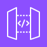
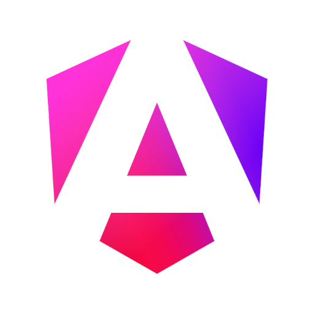
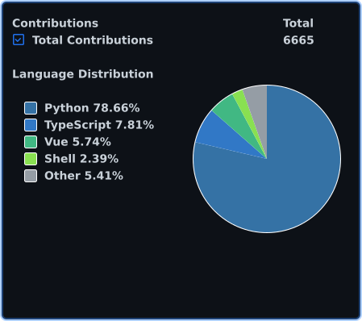
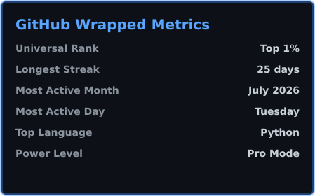

<h1 align="center">Mohamed Rekiba</h1>

  <b>Platform / DevOps Engineer</b>

  

## About me

I build and run cloud platforms: AWS infrastructure, Kubernetes clusters, CI/CD pipelines and secrets management.
I write the tooling around them in Python, Go and Shell.

## Featured projects

<table>
<tr>
<td width="50%" valign="top">
<a href="https://github.com/mohamed-rekiba/arvel"><b>arvel</b></a> <code>Python</code> 
Batteries-included, async-first Python web framework. Type-safe and modular, built on Litestar, msgspec and SQLAlchemy.
</td>
<td width="50%" valign="top">
<a href="https://github.com/mohamed-rekiba/rift"><b>rift</b></a> <code>Go</code> 
Self-hosted SSH tunnels to expose your localhost to the world. Like ngrok, but yours.
</td>
</tr>
<tr>
<td width="50%" valign="top">
<a href="https://github.com/mohamed-rekiba/ansible-bao"><b>ansible-bao</b></a> <code>Python</code> 
Ansible collection for managing OpenBao: secrets engines, auth methods, policies, identity and namespaces.
</td>
<td width="50%" valign="top">
<a href="https://github.com/mohamed-rekiba/cloudkit-cli"><b>cloudkit-cli</b></a> <code>Shell</code> 
Shell helpers for AWS and GCloud.
</td>
</tr>
</table>

## Tech stack

<table>
<tr>
<td><b>Cloud</b></td>
<td>

</td>
</tr>
<tr>
<td><b>Containers</b></td>
<td>

</td>
</tr>
<tr>
<td><b>IaC & Secrets</b></td>
<td>

</td>
</tr>
<tr>
<td><b>CI/CD</b></td>
<td>

</td>
</tr>
<tr>
<td><b>Observability</b></td>
<td>

</td>
</tr>
<tr>
<td><b>Databases</b></td>
<td>

</td>
</tr>
<tr>
<td><b>Languages</b></td>
<td>

</td>
</tr>
</table>

## GitHub activity

<table>
<tr>
<td width="50%" valign="top"></td>
<td width="50%" valign="top"></td>
</tr>
</table>
